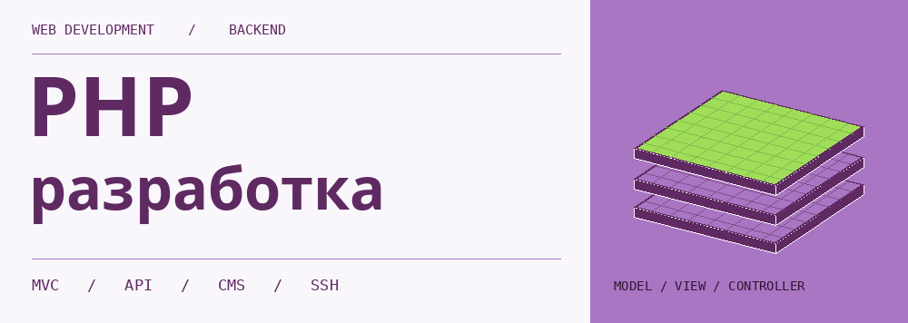

Около четырёх лет занимаюсь веб-разработкой. Начинала с адаптивной вёрстки и WordPress. Сейчас мой основной профиль — PHP и MySQL. Пишу приложения с MVC-архитектурой, разрабатываю API и связываю сайты с внешними сервисами. Работаю и с серверной частью проектов — от подключения по SSH до диагностики ошибок после переноса.

## Избранные задачи

### Онлайн-бронирование

Для банного комплекса дорабатывала проверку занятости через iiko. При расчёте доступного времени учитывала продолжительность сеанса и перерыв на уборку. Тариф выбирается по дате посещения, поэтому при покупке заранее гость видит цену, которая будет действовать в день визита.

### Внутренний магазин мерча

Разрабатывала на PHP API для каталога, заказов и кошельков сотрудников. Реализовала ежемесячное начисление внутренней валюты с учётом роли и индивидуальных условий. Для операций с балансом использовала транзакции MySQL, для авторизации — JWT.

### Каталог недвижимости

Работала с интерактивными поэтажными планами и данными квартир из Profitbase. Дорабатывала вывод полной стоимости квартиры и пересчёт из долларов в сомы по курсу Национального банка Кыргызстана.

## Технологии

| Направление | Что использую |
| --- | --- |
| Бэкенд | PHP, MySQL, MVC, Composer, HTTP API, JSON, JWT |
| 1С-Битрикс | Компоненты, шаблоны, инфоблоки, торговый каталог, корзина и обработчики заказов |
| WordPress | WooCommerce, ACF, пользовательские типы записей, Multisite |
| Фронтенд | HTML, CSS, JavaScript, jQuery, AJAX |
| Интеграции | iiko, amoCRM, Profitbase |
| Разработка и эксплуатация | Git, GitHub, Linux, SSH, cron |

## Хостинг и сопровождение

Настраиваю хостинг, подключаю домены и HTTPS, работаю с DNS и SSH-ключами. Переношу файлы и базы данных, проверяю права доступа и правила Apache. Ошибки разбираю по логам сервера и запросам в браузере. Так, при диагностике сбоя оформления заказа в Битриксе отследила причину до неверного пути к автозагрузчику Composer в интеграции с amoCRM.
